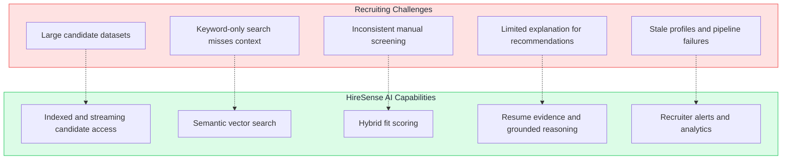
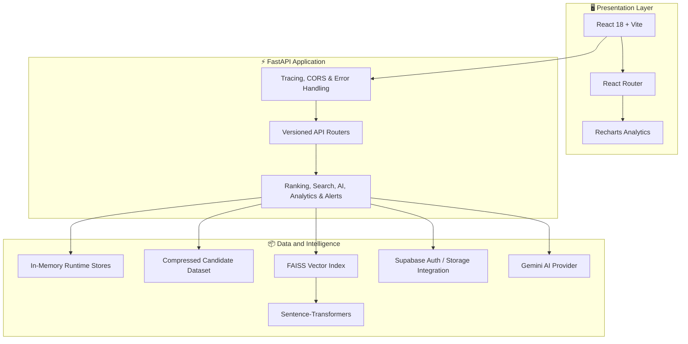
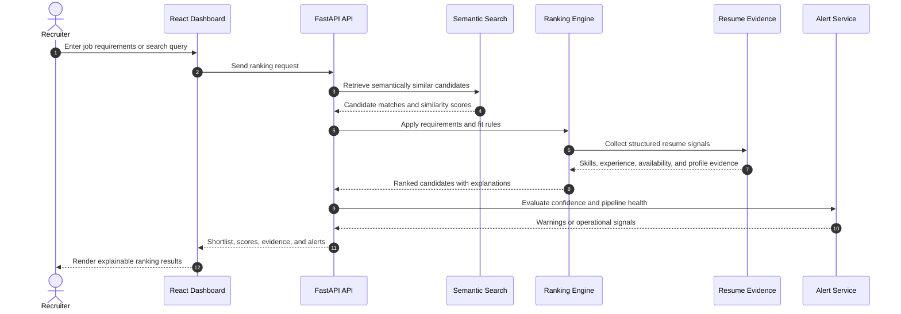

<div align="center">

# 🧠 HireSense AI
## Recruiter Dashboard & Candidate Ranking Platform

[](https://www.python.org/)
[](https://fastapi.tiangolo.com/)
[](https://react.dev/)
[](https://vitejs.dev/)
[](https://faiss.ai/)
[](#)

<p align="center">
  <b>HireSense AI — intelligent candidate discovery, ranking, and recruiter workflow support.</b><br>
  <i>Turn large candidate datasets into explainable, actionable shortlists.</i>
</p>

</div>

---

## 📑 Table of Contents

- [Executive Overview](#-executive-overview)
- [The Problem and the HireSense AI Solution](#-the-problem-and-the-hiresense-ai-solution)
- [System Architecture](#-system-architecture)
- [Candidate Ranking Flow](#-candidate-ranking-flow)
- [Core Capabilities](#-core-capabilities)
- [Technical Stack](#-technical-stack)
- [Scoring and Explainability](#-scoring-and-explainability)
- [Challenge Mode](#-challenge-mode)
- [Repository Structure](#-repository-structure)
- [Local Setup](#-local-setup)
- [Environment Configuration](#-environment-configuration)
- [Deployment](#-deployment)
- [Testing](#-testing)
- [API Overview](#-api-overview)
- [Future Roadmap](#-future-roadmap)

---

## 💡 Executive Overview

HireSense AI is a recruiter-facing candidate ranking and intelligent matching platform. It combines semantic search, vector similarity, deterministic hiring rules, structured resume evidence, and recruiter workflow analytics to help teams identify qualified candidates faster.

The platform is designed for both cloud-connected deployments and constrained evaluation environments. Its challenge mode can process a compressed candidate dataset locally using a pre-calculated byte-offset index, avoiding the need to load an entire dataset into memory before ranking candidates.

HireSense AI focuses on three principles:

1. **Relevant matching** — combine semantic similarity with explicit job requirements.
2. **Explainable recommendations** — support every ranking with structured candidate evidence and reasoning.
3. **Operational visibility** — surface pipeline errors, stale profiles, embedding states, and low-confidence ranking signals.

---

## 🎯 The Problem and the HireSense AI Solution



---

## 🏗️ System Architecture

HireSense AI is organized as a React frontend, a FastAPI backend gateway, and a set of local or cloud-backed intelligence services.



### Data and Responsibility Boundaries

| Layer | Technology | Responsibility |
| :--- | :--- | :--- |
| **Frontend** | React, Vite, Tailwind CSS, Recharts | Recruiter dashboard, candidate views, alerts, analytics, and workflow interaction |
| **API Gateway** | FastAPI, Uvicorn, Pydantic | Request validation, routing, middleware, error handling, and API versioning |
| **Ranking Services** | Python domain modules | Candidate scoring, ranking, fit evaluation, and shortlist generation |
| **Semantic Search** | FAISS + Sentence-Transformers | Vector indexing and similarity-based candidate retrieval |
| **Dataset Layer** | JSONL / gzip + offset index | Efficient local streaming and offline challenge evaluation |
| **Authentication** | Supabase Auth or demo mode | Optional cloud authentication with a local demo bypass |
| **AI Assistance** | Gemini integration | Query expansion, summaries, and recruiter-facing explanations |

---

## 🔄 Candidate Ranking Flow



---

## ✨ Core Capabilities

### 🔎 Semantic Candidate Discovery

Use vector similarity powered by FAISS and Sentence-Transformers to find candidates whose experience is conceptually relevant, even when their resumes do not contain an exact keyword match.

### ⚖️ Hybrid Candidate Scoring

The ranking engine combines semantic relevance with deterministic signals such as:

- Required skill matching
- Experience thresholds
- Profile completeness
- Availability and hiring signals
- Structured resume evidence
- Confidence and quality penalties

### 🧾 Grounded AI Explanations

Candidate recommendations are supported by extracted resume evidence rather than unexplained model output. This helps recruiters understand why a candidate appears in a shortlist and which signals influenced the result.

### 🚨 Recruiter Alert Center

The alert service monitors operational and ranking conditions, including:

- Parsing failures
- Stale candidate profiles
- Missing or pending embeddings
- Low-confidence rankings
- Pipeline health issues

### 📊 Analytics and Insights

The analytics modules expose recruiter-facing aggregates and workflow insights for understanding candidate pipelines, ranking outcomes, and system activity.

### ⚡ Offline and Resource-Constrained Operation

Challenge mode works with a compressed `candidates.jsonl.gz` dataset and an offset index. Candidate records can be accessed without eagerly loading the complete dataset into memory.

---

## 🛠️ Technical Stack

| Category | Technology | Role |
| :--- | :--- | :--- |
| **Backend** | Python 3.11+, FastAPI, Uvicorn | REST API and application gateway |
| **Validation** | Pydantic, JSON Schema | Typed request, response, and dataset validation |
| **Search** | FAISS, NumPy | Vector indexing and nearest-neighbor retrieval |
| **Embeddings** | Sentence-Transformers | Semantic candidate and query representations |
| **AI Provider** | Google Gemini SDK | AI-assisted expansion and explanation workflows |
| **Authentication** | Supabase, JWT | Optional hosted auth and token-based integration |
| **Frontend** | React 18, Vite, React Router | Single-page recruiter dashboard |
| **Styling** | Tailwind CSS, PostCSS | Responsive application styling |
| **Charts** | Recharts | Dashboard and analytics visualizations |
| **Testing** | Pytest, Vitest, Testing Library | Backend and frontend automated tests |

---

## 🧮 Scoring and Explainability

HireSense AI uses a hybrid ranking approach rather than relying on a single similarity score.

```text
Final Candidate Score
    = semantic relevance
    + required skill fit
    + experience fit
    + availability signals
    + profile quality
    - missing requirement penalties
    - low-confidence or incomplete-data penalties
```

The exact weighting is implemented in the backend ranking modules and can be calibrated for the target hiring workflow. Each result is intended to include a human-readable reason and structured evidence so recruiters can inspect the basis of a recommendation.

> Ranking scores should be treated as decision-support signals. Recruiters remain responsible for reviewing evidence and making the final hiring decision.

---

## 🏆 Challenge Mode

Challenge mode supports local dataset preparation and deterministic submission generation.

### Prepare the Dataset

```bash
cd backend
python -m app.challenge.prepare_dataset
```

This prepares the compressed candidate archive, validates the expected schema, and establishes the local offset index.

### Upload the Dataset to Supabase

```bash
cd backend
python -m app.challenge.upload_dataset
```

Use this only when the deployment requires the raw challenge dataset to be published to a configured Supabase Storage bucket.

### Generate the Official Submission

```bash
cd backend
python -m app.challenge.offline_ranker --top-k 100 --strict
```

The generated CSV contains:

```csv
candidate_id,rank,score,reasoning
```

### Generate a Small Sample

```bash
cd backend
python -m app.challenge.offline_ranker \
  --sample \
  --top-k 10 \
  --output exports/sample_check.csv
```

A schema-compatible demo dataset is also available under `backend/demo_data/` for smoke testing.

---

## 📁 Repository Structure

```text
hiresense-ai/
├── README.md                         # Product, architecture, setup, and operations guide
├── .env.example                      # Root/backend environment template
├── start.ps1                         # Windows development startup helper
│
├── backend/                          # FastAPI application and ranking services
│   ├── app/
│   │   ├── api/                      # Versioned routers, middleware, and API handlers
│   │   ├── challenge/                # Dataset preparation, indexing, and offline ranker
│   │   ├── common/                   # Configuration, schemas, repositories, and utilities
│   │   ├── modules/                  # Ranking, alerts, analytics, and domain services
│   │   ├── data/                     # Local challenge data and vector indexes
│   │   ├── demo_data/                # Small schema-compatible smoke-test dataset
│   │   └── main.py                   # FastAPI application and lifespan entrypoint
│   ├── tests/                        # Pytest test suite
│   ├── requirements.txt              # Python dependencies
│   └── exports/                      # Generated shortlist and submission files
│
└── frontend/                         # React + Vite recruiter dashboard
    ├── src/
    │   ├── api/                      # Typed API clients and fetch helpers
    │   ├── components/               # Shared UI components and widgets
    │   ├── pages/                    # Dashboard, alerts, analytics, and ranking views
    │   ├── tests/                    # Frontend test files
    │   └── main.jsx                  # Client entrypoint
    ├── package.json                  # Frontend scripts and dependencies
    └── .env.example                  # Frontend environment template
```

---

## 🚀 Local Setup

### Prerequisites

- Python `3.11+`
- Node.js `18+`
- Git
- A virtual environment manager such as `venv`
- Optional: Supabase and Gemini credentials for cloud-backed features

### 1. Clone the Repository

```bash
git clone https://github.com/kapil31jangid/hiresense-ai.git
cd hiresense-ai
```

### 2. Configure Environment Variables

Copy the root template and fill in only the services you intend to use:

```bash
copy .env.example .env
```

For frontend-only configuration:

```bash
copy frontend/.env.example frontend/.env
```

On macOS/Linux, use `cp` instead of `copy`.

### 3. Install and Run the Backend

```bash
cd backend
python -m venv .venv
```

Activate the environment:

```bash
# Windows PowerShell
.venv\Scripts\Activate.ps1

# macOS/Linux
source .venv/bin/activate
```

Install dependencies and start FastAPI:

```bash
pip install -r requirements.txt
uvicorn app.main:app --host 127.0.0.1 --port 8000
```

The backend is available at:

- API base: `http://127.0.0.1:8000/api/v1`
- OpenAPI documentation: `http://127.0.0.1:8000/docs`
- ReDoc documentation: `http://127.0.0.1:8000/redoc`

### 4. Install and Run the Frontend

Open another terminal:

```bash
cd frontend
npm install
npm run dev
```

The Vite frontend normally runs at `http://127.0.0.1:3000` and proxies API requests according to the frontend configuration.

---

## ⚙️ Environment Configuration

The root `.env.example` contains the complete configuration template. Important settings include:

| Variable | Description | Local Example |
| :--- | :--- | :--- |
| `ENVIRONMENT` | Runtime environment name | `development` |
| `DEMO_AUTH_ENABLED` | Enables local demo authentication | `true` |
| `BACKEND_HOST` | API bind host | `127.0.0.1` |
| `BACKEND_PORT` | API port | `8000` |
| `API_BASE_URL` | Frontend-facing API base URL | `http://127.0.0.1:8000/api/v1` |
| `AI_PROVIDER_MODE` | Configured AI provider mode | `gemini` |
| `EMBEDDING_MODEL_NAME` | Sentence-Transformers model | `all-MiniLM-L6-v2` |
| `FAISS_INDEX_DIR` | Vector index directory | `backend/data/faiss` |
| `CHALLENGE_DATASET_AUTOLOAD` | Loads challenge data at startup | `true` |
| `SUPABASE_URL` | Backend Supabase project URL | Optional |
| `GOOGLE_API_KEY` | Gemini / Google AI credential | Optional |

Do not commit real secrets, Supabase service-role keys, JWT secrets, or cloud credentials to the repository.

---

## 🌐 Deployment

### Backend — Render

1. Create a new Render Web Service connected to this repository.
2. Set the root directory to `backend`.
3. Use the build command:

   ```bash
   pip install -r requirements.txt
   ```

4. Use the start command:

   ```bash
   uvicorn app.main:app --host 0.0.0.0 --port $PORT
   ```

5. Configure the required environment variables from `.env.example`.
6. Set `PYTHON_VERSION` to a supported Python 3.11 runtime when required by the deployment environment.

### Frontend — Vercel

1. Create a Vercel project connected to this repository.
2. Set the root directory to `frontend`.
3. Select the Vite framework preset.
4. Configure the frontend environment variables.
5. Point the frontend API configuration to the deployed backend URL.

The repository is configured with a deployed frontend homepage at the project-level Vercel deployment when the corresponding environment variables are available.

---

## 🧪 Testing

### Backend Tests

```bash
cd backend
.venv\Scripts\Activate.ps1  # Windows PowerShell
pytest
```

The backend suite covers API behavior, repositories, ranking logic, challenge utilities, and application services.

### Frontend Tests

```bash
cd frontend
npm run test
```

The frontend suite uses Vitest, JSDOM, React Testing Library, and user-event helpers.

### Frontend Production Build

```bash
cd frontend
npm run build
```

---

## 🔌 API Overview

The FastAPI application exposes versioned routers under `/api/v1`:

| Router | Purpose |
| :--- | :--- |
| `/health` | Service health and readiness checks |
| `/jobs` | Job and hiring requirement workflows |
| `/candidates` | Candidate retrieval and profile operations |
| `/rankings` | Candidate ranking and shortlist generation |
| `/semantic-search` | Semantic candidate discovery |
| `/ai` | AI-assisted recruiter workflows |
| `/analytics` | Pipeline and ranking analytics |
| `/alerts` | Pipeline health and ranking alerts |
| `/pipeline` | Candidate processing and workflow state |

Interactive API documentation is generated automatically by FastAPI at `/docs`.

---

## 🔮 Future Roadmap

- Persistent production-grade candidate and job storage
- More configurable ranking weights and recruiter-specific calibration
- Batch embedding and background processing workers
- Fine-grained organization and recruiter permissions
- Improved evaluation dashboards for ranking quality and fairness
- Candidate deduplication and profile versioning
- PII redaction and privacy-aware resume sharing
- Audit logging for ranking changes and recruiter actions
- Containerized deployment and managed vector infrastructure

---

## 🤝 Contributing

1. Create a feature branch.
2. Keep backend and frontend tests updated with behavior changes.
3. Do not commit `.env` files or credentials.
4. Run the relevant test suites before opening a pull request.
5. Document new environment variables, commands, and API routes in this README.

---

<div align="center">
  <sub>HireSense AI • Explainable candidate intelligence for modern recruiting workflows</sub>
</div>
